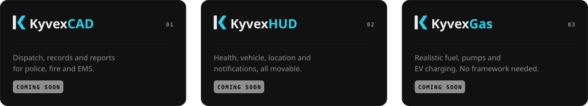

 

## About Kyvex

Kyvex Development builds software, scripts and tools, starting with FiveM resources for GTA V roleplay servers. Clean, original designs that are easy to set up.

We also build custom systems for servers. Reach out on Discord.

## Products

## Tech and standards

## Links

